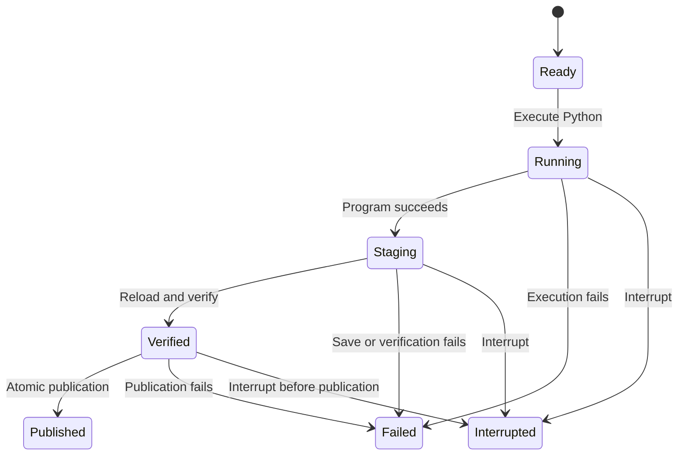

# Python execution and checkpoint publication

The model starts with a ready program, executes it, stages a checkpoint after successful evaluation, reloads and verifies that checkpoint, and publishes it atomically. Failure and interruption before publication leave no published checkpoint. Publication is terminal.



TLC explored 9 states and 15 transitions. `PublishedOnlyVerified`, `FailedNeverPublished`, `PublicationIsTerminal`, and the deadlock check hold. The chart hides terminal self-loops. This is a bounded lifecycle model, not a proof that arbitrary Python or a storage service is safe.

Reproduce it outside the repository, using a new output directory:

```sh
/root/.agents/skills/statechart/scripts/statechart \
  docs/design/coding-statechart/Program.tla \
  --config docs/design/coding-statechart/Program.cfg \
  --view docs/design/coding-statechart/view.mjs \
  --out /tmp/wsm-coding-statechart-fresh
```

The checker needs Java and TLC. Set `JAVA` and `TLA2TOOLS` if its mise installer is unavailable. The [specification](coding-statechart/Program.tla), [configuration](coding-statechart/Program.cfg), and [checker report](coding-statechart/report.md) are retained together.

The model excludes process death during receipt writes, power loss, storage durability guarantees, malicious edits, and concurrent mutation of a live model. A killed process can leave a nonterminal journal and unpublished staging files. Treat that journal as uncertain and inspect the checkpoint directory before retrying. Atomic publication is the completion boundary; a receipt-writing failure after publication must not relabel a published checkpoint as failed or interrupted.
